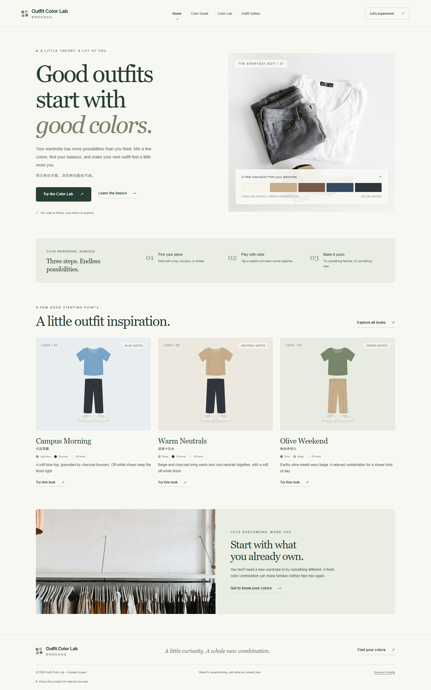

# web-project / Outfit Color Lab · 穿搭配色实验室

A simple color tool that helps students plan outfits using clothes they already own.

- Public website: https://chengdianjiang0705-dotcom.github.io/web-project/
- Repository: https://github.com/chengdianjiang0705-dotcom/web-project



## Run locally

Requires Node.js 20 or newer. No install, account, database, API key or paid service is needed.

```sh
npm run dev
```

Open http://127.0.0.1:4173. Build a portable static site with `npm run build`.

## Pages

| Page | Purpose |
| --- | --- |
| `index.html` | Introduce the tool, explain three steps and show featured outfits. |
| `guide.html` | Explain neutrals, tonal dressing and an accent color. |
| `lab.html` | Independently recolor a top, trousers and shoes. |
| `looks.html` | Filter and load six outfit presets. |
| `project.html` | Record the coursework planning and real development process. |

See `docs/PROCESS.md` for actual development milestones, `docs/SOURCES.md` for attribution, and `docs/SUBMISSION.md` for course submission material.

## Verify and publish

```sh
npm run check
npm test
npm run build
```

Pushing `main` triggers `.github/workflows/pages.yml`: static validation, state tests, metadata configuration, build and GitHub Pages deployment. No repository secrets are required. All site files use relative URLs so GitHub's `/web-project/` path works.

Browser QA and desktop/mobile screenshots are recorded in `docs/TESTING.md`. To repeat browser QA, provide an installed Playwright module and Chromium browser (see `scripts/browser-qa.mjs`), then run it with `--serve`. The website itself has no third-party runtime dependencies.

Course materials: [`docs/SUBMISSION.md`](docs/SUBMISSION.md), [`docs/DEFENCE.md`](docs/DEFENCE.md), and [`project.html`](project.html). The early cover is preserved at `docs/design/cover-v1.jpg`; the final cover reuses the same original garments as the website.

## Development transparency

This project is built with AI assistance. The recorded commits represent actual changes made during this session; they do not claim development over earlier weeks. The student should review the code and final content before presenting the work as required by the course.
